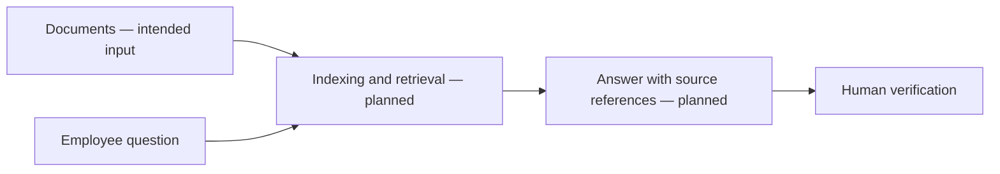
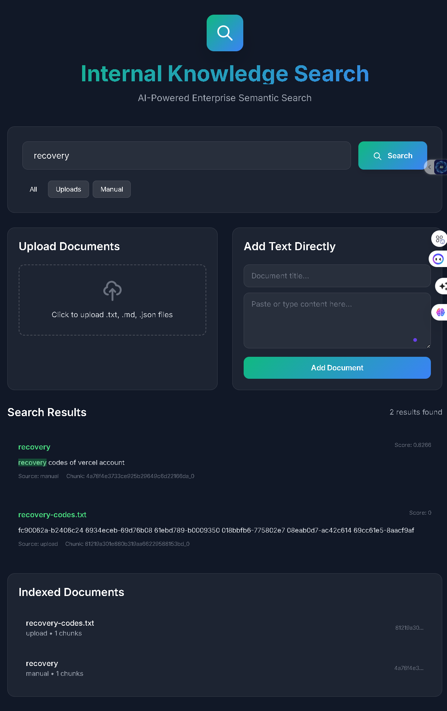

# Internal Knowledge Search

<strong>A RAG project concept for finding answers across internal documents and enterprise knowledge.</strong>

## Intended workflow

This is a conceptual diagram. The repository currently contains visual reference files only; the application source, deployment configuration, and run instructions are not tracked.

## Project visuals

## Make it reproducible

Add the app source and explain document ingestion, access controls, indexing, source citations, and data retention. Enterprise search must preserve the permissions of the original documents; a generated answer should not bypass them.
